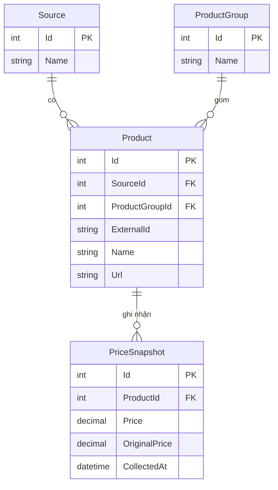
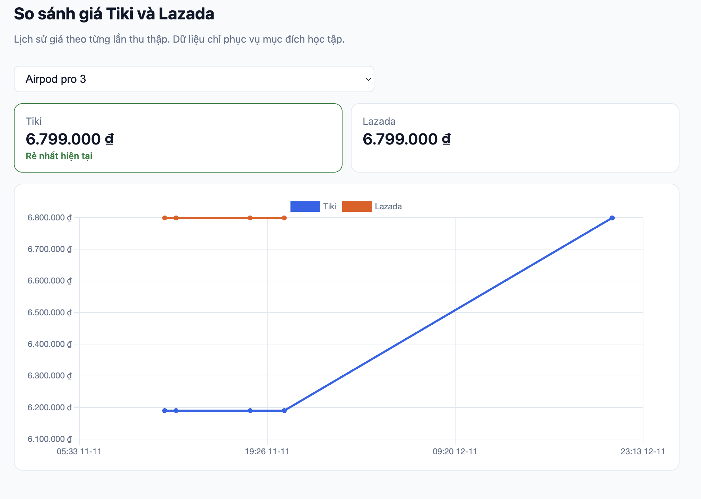
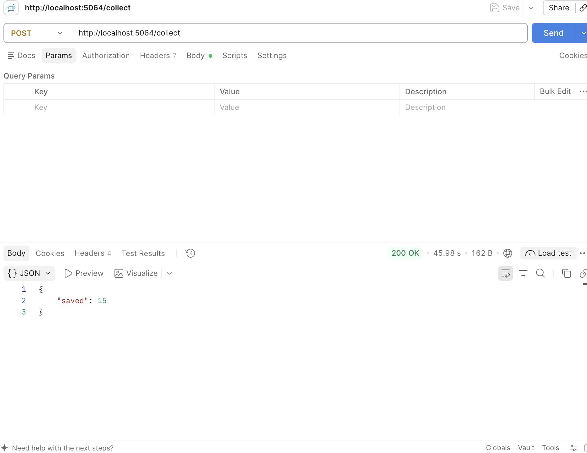
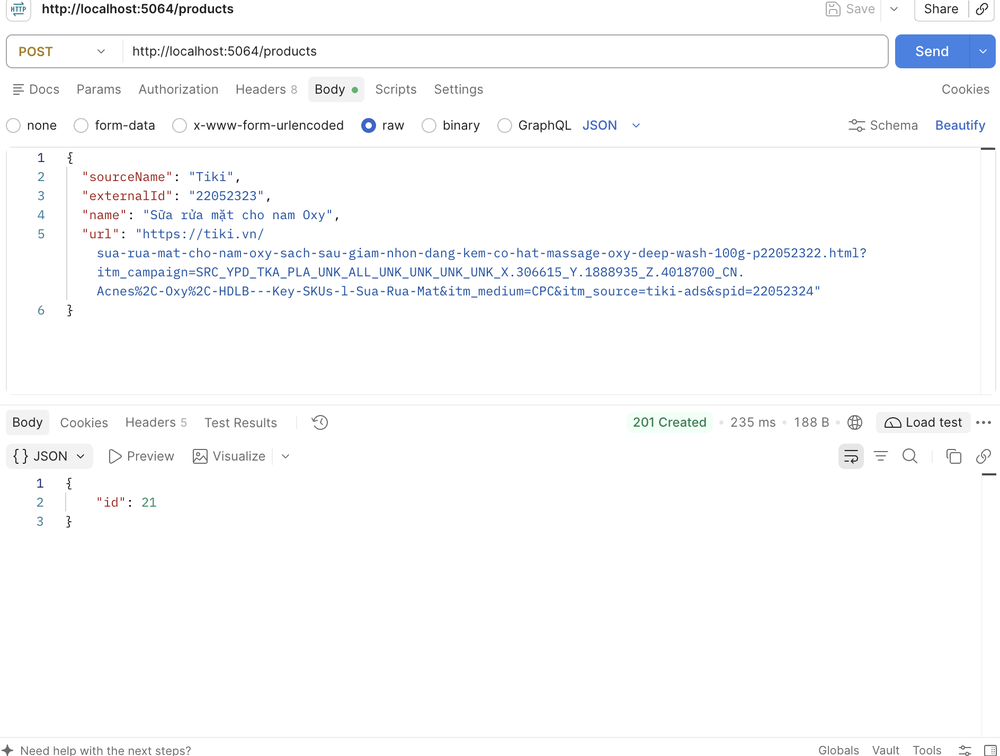
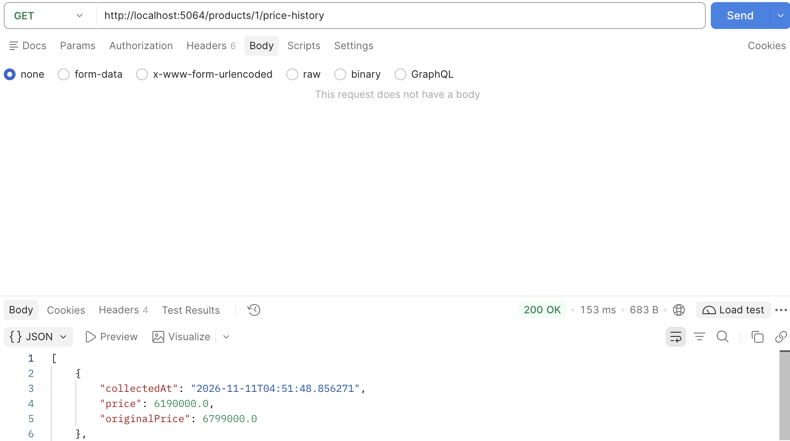

# Price Tracker: So sánh giá Tiki và Lazada

Dự án backend nhỏ theo dõi giá sản phẩm trên **Tiki** và **Lazada**, lưu lịch sử giá và so sánh giữa hai sàn bằng API cùng một trang biểu đồ.

> Đây là dự án học tập, chỉ theo dõi một số ít sản phẩm và chỉ dùng dữ liệu công khai.

## Tính năng

- Thu thập giá định kỳ từ Tiki (API JSON công khai) và Lazada (trang sản phẩm công khai)
- Lưu lịch sử giá: mỗi lần thu thập là một bản ghi mới, không ghi đè giá cũ
- Ghép cùng một sản phẩm giữa hai sàn theo nhóm (`ProductGroup`) để so sánh
- API so sánh giá và lịch sử giá
- Trang web biểu đồ biến động giá (Chart.js)
- Tự động thu thập theo chu kỳ bằng `BackgroundService`, có xử lý lỗi từng sản phẩm

## Công nghệ

ASP.NET Core (minimal API), Entity Framework Core, SQLite, Chart.js

## Kiến trúc

```
IPriceCollector
 ├── TikiCollector     (gọi API JSON của Tiki)
 └── LazadaCollector   (đọc giá từ HTML trang sản phẩm)

PriceCollectionService   duyệt các sản phẩm, gọi collector tương ứng, lưu PriceSnapshot
PriceCollectorWorker     BackgroundService chạy PriceCollectionService theo chu kỳ
```

Mỗi sàn là một class cài đặt `IPriceCollector`, nên thêm sàn mới chỉ cần viết thêm một collector.

### Sơ đồ cơ sở dữ liệu



## Cách chạy

Yêu cầu: .NET SDK (đã thử với .NET 10).

```bash
dotnet tool install --global dotnet-ef   # nếu chưa có
dotnet ef database update                # tạo database SQLite
dotnet run
```

Sau đó (cổng xem trong terminal, mặc định `http://localhost:5064`):

1. `POST /seed`: nạp danh sách sản phẩm từ `Products.json`
2. `POST /collect`: thu thập giá lần đầu (mất khoảng 30 giây vì có giãn cách giữa các request)
3. Mở `http://localhost:5064/` để xem biểu đồ

## API

| Phương thức | Đường dẫn | Mô tả |
|---|---|---|
| GET | `/groups` | Danh sách nhóm sản phẩm kèm giá mới nhất ở mỗi sàn |
| GET | `/groups/{id}/compare` | Lịch sử giá theo từng sàn của một nhóm, kèm sàn đang rẻ nhất |
| GET | `/products` | Danh sách sản phẩm theo từng sàn và giá mới nhất |
| POST | `/products` | Thêm một sản phẩm cần theo dõi |
| GET | `/products/{id}/price-history` | Lịch sử giá của một sản phẩm |
| POST | `/seed` | Nạp sản phẩm từ `Products.json` (chạy lại không bị trùng) |
| POST | `/collect` | Thu thập giá thủ công |

## Cấu hình

Chu kỳ thu thập tự động (phút) trong `appsettings.json`, mặc định 360:

```json
"Collector": { "IntervalMinutes": 120 }
```

## Về dữ liệu

- **Tiki:** gọi endpoint JSON công khai theo id sản phẩm và `spid` (người bán/biến thể).
- **Lazada:** đọc giá từ trang sản phẩm công khai (không đăng nhập, không dùng API riêng).
- Giãn cách 1,5 giây giữa các request, chỉ theo dõi một số ít sản phẩm.
- Thời gian lưu theo UTC.
- Nếu một sàn chặn hoặc đổi cấu trúc trang, collector ghi log lỗi và bỏ qua sản phẩm đó, các sản phẩm khác vẫn được xử lý.

## Hạn chế và hướng phát triển

- Việc ghép sản phẩm giữa hai sàn đang làm thủ công qua `Products.json`
- Phần đọc giá Lazada phụ thuộc cấu trúc trang nên có thể phải cập nhật khi Lazada thay đổi
- Có thể thêm: unit test, Docker, cảnh báo khi giá giảm, thêm sàn khác bằng một collector mới


## Ảnh minh họa

### Giao diện biểu đồ biến động giá (Chart.js)


### Thu thập dữ liệu giá tự động (`POST /collect`)


### Danh sách sản phẩm & giá mới nhất (`GET /products`)


### Lịch sử biến động giá (`GET /products/{id}/price-history`)


---

**Tác giả:** Nguyễn Đắc Minh  
**Repository:** [https://github.com/bibabibo112/PriceTracker](https://github.com/bibabibo112/PriceTracker)
